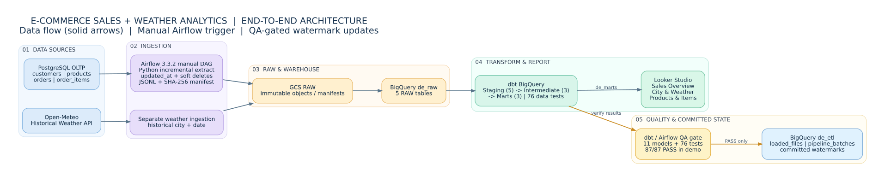
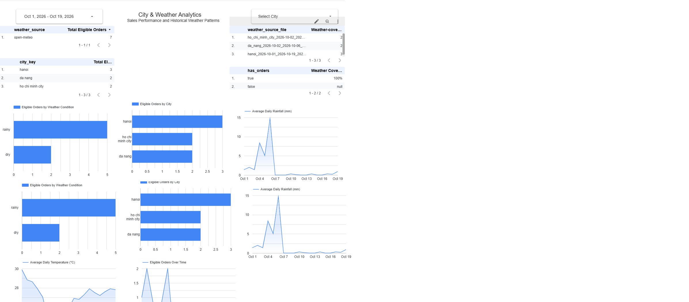
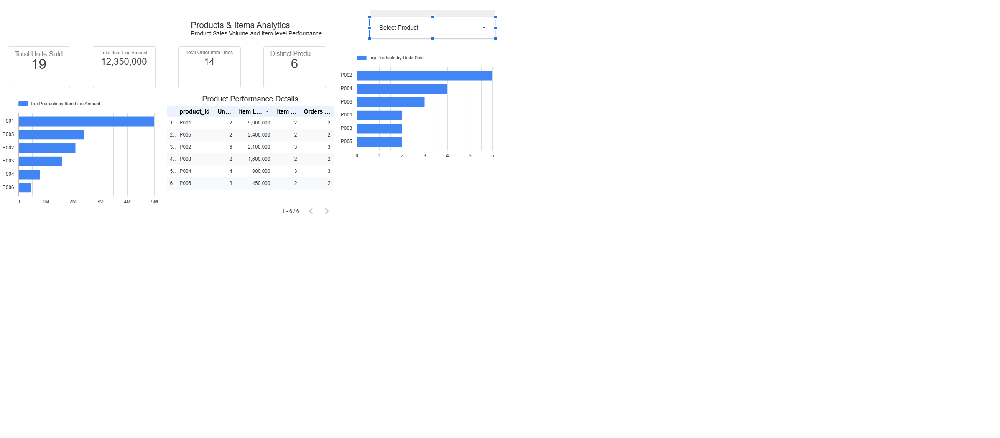

# E-commerce Sales & Weather Analytics Pipeline

**An end-to-end data engineering portfolio project combining e-commerce transactions and historical weather data for business analytics.**

**Tech stack:** Python · PostgreSQL · Google Cloud Storage (GCS) · BigQuery · dbt · Apache Airflow · Docker · Looker Studio · Git/GitHub

> **Project status:** Completed as a learning and portfolio demo through dashboarding (Days 1–9). The main Airflow pipeline is **manually triggered**, and this project is **not presented as production-ready CDC or an exactly-once system**.

## 1. Business problem

E-commerce transaction data answers questions about orders, products, and cities, while historical weather adds useful context about local conditions on each business day. This project combines both sources to explore:

- How do eligible order counts, order amounts, and average order value vary across cities and dates?
- Which products lead by units sold, and which contribute the most item-line value?
- How do orders in the demo dataset distribute across rainy, dry, and unknown-weather days?
- How complete is the weather coverage of the orders being analyzed?
- Can downstream analytics reflect inserts, updates, and soft deletes from the source database?

The data is a small demo/synthetic sample. Weather comparisons are **descriptive**, not evidence of causation.

## 2. Architecture



See the [architecture walkthrough and checkpoint logic](docs/architecture.md). A high-resolution [PNG version](docs/architecture.png) is also available.

**Important scope distinction:** The Airflow DAG coordinates the incremental **transactional** path. Historical Open-Meteo ingestion was implemented separately; the current transaction DAG does not fetch fresh weather observations on every run.

### Main components

| Component | Implementation |
| --- | --- |
| Transaction source | PostgreSQL database `ecommerce_source` |
| External source | Open-Meteo Historical Weather API |
| Raw storage | GCS bucket `gs://weather-data-project-512207-raw` |
| Cloud warehouse | Google BigQuery, project `weather-data-project-512207`, location `asia-southeast1` |
| Transformation and tests | dbt Core `1.12.6` and dbt BigQuery `1.12.1` |
| Orchestration | Apache Airflow `3.3.2` in local Docker/WSL2 |
| Reporting | Looker Studio, three report pages |

## 3. Data sources and ingestion

### Transactional source

The PostgreSQL source has four related tables:

| Table | Role |
| --- | --- |
| `customers` | Customer identifiers, names, and cities |
| `products` | Product catalog, categories, and prices |
| `orders` | Order dates, statuses, amounts, and soft-delete flags |
| `order_items` | Products, quantities, and unit prices for each order |

Source SQL is available in [`sql/`](sql/).

### Incremental extraction and simulated CDC

- Python reads rows updated after the last committed watermark and before a run cutoff, using `updated_at`.
- The extractor produces JSONL batches with source metadata, immutable manifests, row counts, and SHA-256 checksums.
- Files are stored in GCS before loading into BigQuery RAW tables.
- INSERT and UPDATE changes are demonstrated. Deletions are represented by **soft deletes** (`is_deleted`), not hard-delete capture.
- **Committed watermarks are stored in `de_etl.watermarks` and advance only after downstream quality checks pass.**

The main Airflow-compatible extractor is `src/ingestion/extract_incremental_airflow.py`. The earlier `src/ingestion/extract_incremental.py` is retained as a **legacy learning artifact** and must not be substituted into the current DAG: its older local checkpoint flow committed too early.

### Weather source

Historical weather is retrieved using `src/ingestion/extract_weather.py` and modeled at the **city + calendar date** level. Variables include daily rainfall (`rain_sum`) and mean temperature (`temperature_2m_mean`). Missing observations remain **unknown / NULL**, rather than being converted to zero rainfall or 0°C.

## 4. BigQuery and dbt modeling

| Dataset | Contents | Purpose |
| --- | --- | --- |
| `de_raw` | Customers, products, orders, order items, weather API responses | Loaded source-level records |
| `de_etl` | `loaded_files`, `pipeline_batches`, `watermarks` | Ingestion registry, batch tracking, committed checkpoints |
| `de_staging` | 5 models | Cleaning, type normalization, latest-record deduplication |
| `de_intermediate` | 3 models | Reusable business rules and order/weather joins |
| `de_marts` | 3 models | Dashboard-ready facts and aggregates |

The primary dbt project is [`ecommerce_weather_dbt_bigquery/`](ecommerce_weather_dbt_bigquery/). Its recorded validation result is **11 models + 76 data tests = 87/87 successful executions** in the completed demo runs.

### Mart grains and KPI definitions

| Model | Grain | Example measures / rules |
| --- | --- | --- |
| `fct_orders` | One eligible order per row | Eligible order count; sum of eligible order amounts; AOV |
| `fct_order_items` | One eligible item line per row | Units sold; item-line amount; distinct item lines |
| `mart_city_day` | One city and one business date per row | `SUM(order_count)` across city-days; weather conditions and coverage |

Detailed reference: [Data Dictionary & Logical Lineage](docs/data_dictionary.md) · [KPI Definitions & Read-Only Reconciliation SQL](docs/kpi_definitions.md).

**Eligibility:** `status IN ('paid', 'shipped', 'delivered') AND is_deleted IS FALSE`.

**Business date:** `DATE(order_date, 'Asia/Ho_Chi_Minh')`.

**Eligible order amount / AOV:** On `fct_orders`, use `SUM(total_amount)` and divide by eligible order count for AOV. On `mart_city_day`, use `SUM(total_order_amount)` and `SUM(order_count)` over a matching date scope. These field names were verified against BigQuery `INFORMATION_SCHEMA` on 20 November 2026; `fct_orders.total_items_amount` is a different measure.

**Weather classification:** rainy when `rain_sum_mm > 0`, dry when `rain_sum_mm = 0`, and unknown when weather is missing.

**Avoid double counting:** An order can contain many order items. Do not sum order totals after joining to item-level rows, and do not use `Record Count` of `mart_city_day` as an order count. Item-line amounts and order-level amounts need not reconcile exactly because they represent different measures.

## 5. Airflow orchestration and reliability

The main DAG is `day8_auto_incremental_pipeline` in [`dags/day8_auto_incremental_pipeline.py`](dags/day8_auto_incremental_pipeline.py).

- **Trigger:** Manual (`schedule=None`), with an explicit write-confirmation value (`confirm_write=RUN_AUTO_PIPELINE`).
- **Empty batch:** Branches to a successful empty-batch finalizer; downstream write tasks are intentionally skipped.
- **Nonempty batch:** Prepares an incremental batch, uploads/verifies GCS RAW, loads BigQuery RAW, runs dbt transformation/tests, verifies finalization, and commits four watermarks **only after QA passes**.
- **Replay/idempotency:** File checksums and registry metadata support verified replays and duplicate-file prevention within the demonstrated scope.

### Demonstrated validation

| Scenario | Observed demo result |
| --- | --- |
| dbt BigQuery model/test execution | **87/87 PASS** |
| Empty-batch Airflow branch | Expected success and skipped write tasks |
| Nonempty incremental processing and C990 V1/V2/V3 | Successful demo with latest-state update |
| Retry drill | **4/4 PASS** |
| Local/SQLite partial-write recovery sandbox | **8/8 PASS** |

These tests do **not** establish end-to-end exactly-once behavior under all real GCS/BigQuery failures or concurrent runs. The DAG does not yet run on a production schedule.

Evidence: [Airflow nonempty run](docs/screenshots/day8_auto_pipeline_nonempty_success.png) · [dbt tests](docs/screenshots/day8_auto_pipeline_dbt_87_pass.png) · [QA/watermark commit](docs/screenshots/day8_auto_pipeline_watermark_commit.png) · [Recovery sandbox](docs/screenshots/day8_partial_failure_8_cases.png).

## 6. Looker Studio dashboards

Three dashboard pages were built using BigQuery `de_marts` models:

### Sales Overview

Eligible orders, order amounts, average order value, time trend, and city/status filtering.


### City & Weather

City-level sales metrics, rainfall/temperature context, weather categories, and coverage analysis.



### Products & Items

Units sold, item-line value, item counts, distinct products, and top-product comparisons.



### Illustrative insights from the October 2026 demo snapshot

- **City distribution:** 7 eligible orders: Hanoi 3, Da Nang 2, Ho Chi Minh City 2.
- **Weather distribution:** 5 of the 7 eligible orders fell on rainy city-days and 2 on dry city-days; this does not imply weather caused orders.
- **Item-line value leader:** Product P001 accounted for 5,000,000 of the 12,350,000 total item-line amount (**about 40.5%**, in the source's amount units).
- **Unit-volume leader:** Product P002 sold 6 of 19 units (**about 31.6%**).
- **Observed weather matching:** 7/7 eligible orders matched a weather city-day (**100% order-level coverage** in this small snapshot, not a guarantee of complete weather variables).

Numbers above are **historical snapshots**, not live dashboard totals. The item-line metrics may use a different effective date scope than the order-based city/weather dashboard, and no currency is asserted here without confirming the source contract.

Read the full [five Business Insights](docs/day9_business_insights.md). Supporting evidence includes [sales reconciliation](docs/screenshots/day9_28_sales_city_reconciliation.png), [weather coverage validation](docs/screenshots/day9_29_weather_coverage_validation.png), and [item-level BigQuery validation](docs/screenshots/day9_items_bigquery_validation.png).

## 7. Repository structure

```text
.
├── dags/                               # Airflow DAGs and test/preflight tools
├── src/                                # Python extraction, loading and helpers
├── sql/                                # PostgreSQL and BigQuery scripts
├── ecommerce_weather_dbt_bigquery/     # Primary BigQuery dbt project
├── ecommerce_weather_dbt/              # Legacy PostgreSQL dbt project
├── docs/
│   ├── day9_business_insights.md
│   ├── PROJECT_PROGRESS.md
│   └── screenshots/                    # Airflow, dbt, BigQuery, dashboard evidence
├── requirements-gcp.txt
├── requirements-dbt-bigquery.txt
├── .gitignore
└── README.md
```

The legacy development path previously used **private Hugging Face RAW storage** and a **PostgreSQL analytics warehouse**. It remains in the repository as a record of architectural evolution; the current cloud analytics path is **GCS + BigQuery + dbt BigQuery**.

## 8. Setup and reproduction notes

This is a cloud-connected demo rather than a one-command turnkey application. To reproduce the architecture safely:

1. Clone this repository and set up separate Python environments as required by the ingestion and dbt dependency files.
2. Provision a PostgreSQL transactional source from the SQL scripts and seed/demo data.
3. Configure a GCP project, GCS RAW bucket, and BigQuery datasets with suitable region, IAM permissions, and billing controls.
4. Configure BigQuery authentication and a **local, uncommitted** dbt `profiles.yml` for the correct project and datasets.
5. Configure Airflow 3.3.2 in Docker with required PostgreSQL/GCP connections and the repository's `dags/` and source code mounted into the containers.
6. Validate connectivity, dbt models, data tests, and checkpoint state **before intentionally triggering any write-capable pipeline**.
7. Connect Looker Studio to the resulting BigQuery mart views and verify metrics at the correct grain and date scope.

**Current reproducibility gap:** The original local Airflow Compose setup was maintained outside this repository (`airflow-day8` on the author's machine). A sanitized Compose sample, detailed environment setup, and operational runbook are part of the final documentation work; do not treat the repository as independently deployable until those are included and verified.

**Safety:** Never commit `.env`, service-account JSON, OAuth tokens, credentials, private profiles, local checkpoints, runtime logs, virtual environments, or raw data containing secrets. The committed BigQuery `de_etl.watermarks` table is the source of truth for the current incremental DAG; do not reset it to reproduce an old batch.

## 9. Demo walkthrough (5–10 minutes)

1. **Business objective:** Explain why transaction data and historical weather are analyzed together.
2. **Architecture:** Walk through PostgreSQL, incremental extract, GCS RAW, BigQuery layers, dbt, Airflow, and Looker Studio. Clarify the separate weather ingestion path.
3. **Incremental behavior:** Show saved evidence of the C990 insert/update experiments, file-level replay checks, and QA-gated watermark commits.
4. **Data quality and reliability:** Show 87/87 dbt results plus empty-batch, retry, and recovery evidence.
5. **Business results and limitations:** Open the three dashboard pages or screenshots, explain one insight per page, and distinguish snapshot association from causality.

See also the [Airflow completion report](dags/DAY8_AIRFLOW_COMPLETION_REPORT.md) and [project progress notes](docs/PROJECT_PROGRESS.md).

## 10. Limitations and possible improvements

| Current scope / limitation | Possible next step |
| --- | --- |
| `updated_at` incremental + soft delete, not true WAL-based CDC | Evaluate Datastream/Debezium or a proper change log with hard-delete handling |
| Manual Airflow DAG execution | Add carefully tested scheduling, monitoring, and alerts |
| File-level idempotency; recovery partly validated in a local sandbox | Test real partial failures, concurrency, and durable cloud recovery |
| Small synthetic/demo transaction dataset | Use larger, more realistic data and assess statistical uncertainty |
| Weather association is not causal | Add controlled study design and more context before causal claims |
| Local external Compose and manual infrastructure setup | Add sanitized Compose templates, environment documentation, and CI |
| Potential BigQuery scan/cost growth | Add budgets, partitioning/clustering reviews, and query cost monitoring |

**Project scope:** This repository demonstrates data engineering architecture, modeling, quality controls, and analytical communication for a portfolio. It should not be described as a fully automated, production-certified data platform.
