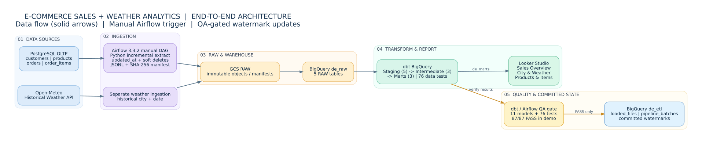

# End-to-End Architecture

The architecture separates **transactional ingestion** from **historical weather ingestion**. Both paths feed GCS RAW and BigQuery analytical layers. The main Airflow DAG orchestrates the *transactional* path and is manually triggered; weather collection is not part of each transaction DAG run.

## 1. Transactional data path

1. **PostgreSQL OLTP:** `ecommerce_source` holds `customers`, `products`, `orders`, and `order_items`.
2. **Incremental Python extractor:** Reads records by `updated_at` between the committed checkpoint and a run cutoff. It captures inserts, updates, and soft deletes (`is_deleted`), then prepares JSONL and immutable metadata/manifests with SHA-256 checksums.
3. **GCS RAW:** Stores batch-level raw objects and manifests, preserving material for traceability and replay.
4. **BigQuery `de_raw`:** Stores the loaded source-level events and weather API responses. File and batch metadata is tracked in `de_etl`.
5. **dbt BigQuery:** Five staging models, three intermediate models, and three marts implement cleaning, latest-record state, business logic, and dashboard-ready datasets.
6. **Looker Studio:** Reads the mart views: `fct_orders`, `fct_order_items`, and `mart_city_day`.

## 2. Weather data path

Open-Meteo Historical Weather API responses are collected by a **separate** Python ingestion path, preserved as RAW JSON in GCS, loaded into BigQuery, and transformed by dbt. Weather is joined to sales analysis using **city and business date**. Missing values remain unknown/NULL rather than being treated as dry weather or a temperature of zero.

## 3. Airflow, QA gate, and committed watermarks

The current primary DAG is `day8_auto_incremental_pipeline` (Apache Airflow `3.3.2`), with `schedule=None` and an explicit manual write confirmation.

For each intentional transaction run:

1. Airflow reads **committed checkpoints** from BigQuery `de_etl.watermarks` and prepares an incremental batch.
2. An empty batch follows the success/skip branch without downstream writes.
3. A nonempty batch goes through GCS verification, BigQuery RAW loading, and dbt processing.
4. Only after downstream validation passes does the DAG **commit four watermarks** and export the per-run checkpoint.
5. A subsequent run reads those committed watermarks again. This feedback loop is described here rather than drawn as a crossing arrow in the high-level architecture image.

`de_etl.loaded_files` and `de_etl.pipeline_batches` support file/batch tracking; `de_etl.watermarks` is the authoritative incremental checkpoint table for the current DAG. Do not reset it or replace it with the earlier local JSON checkpoint.

## 4. Recorded verification and limitations

- Demo validation: **11 dbt models + 76 data tests = 87/87 PASS**.
- Airflow empty and nonempty branches, C990 updates, and QA-gated checkpoint commit were demonstrated.
- Recovery evidence includes **4/4 retry-drill tasks** and **8/8 local/SQLite failure scenarios**.
- The pipeline is **not** advertised as WAL CDC, fully scheduled, or end-to-end exactly-once under arbitrary cloud failures/concurrent runs.
- Weather and business trends are descriptive, based on a small demo dataset.

For supporting evidence, see [`DAY8_AIRFLOW_COMPLETION_REPORT.md`](../dags/DAY8_AIRFLOW_COMPLETION_REPORT.md), the [`screenshots/`](screenshots/) folder, and the [Day 9 Business Insights](day9_business_insights.md).

## 5. Diagram files

- `architecture.svg`: scalable image used in the repository README.
- `architecture.png`: raster version for presentations or screenshots.
- `architecture.dot`: editable Graphviz source for future changes.
